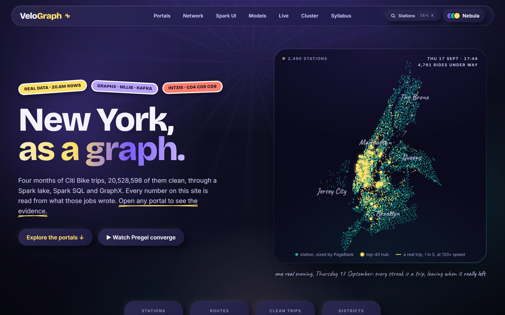
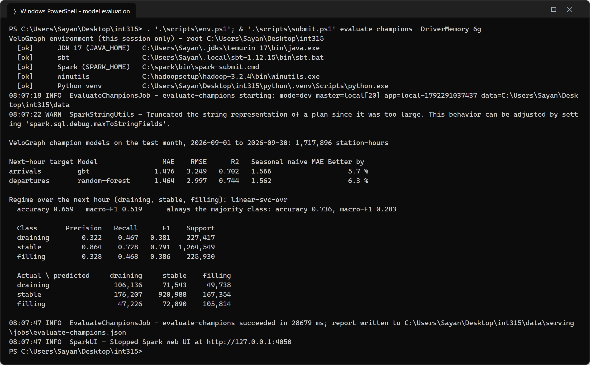
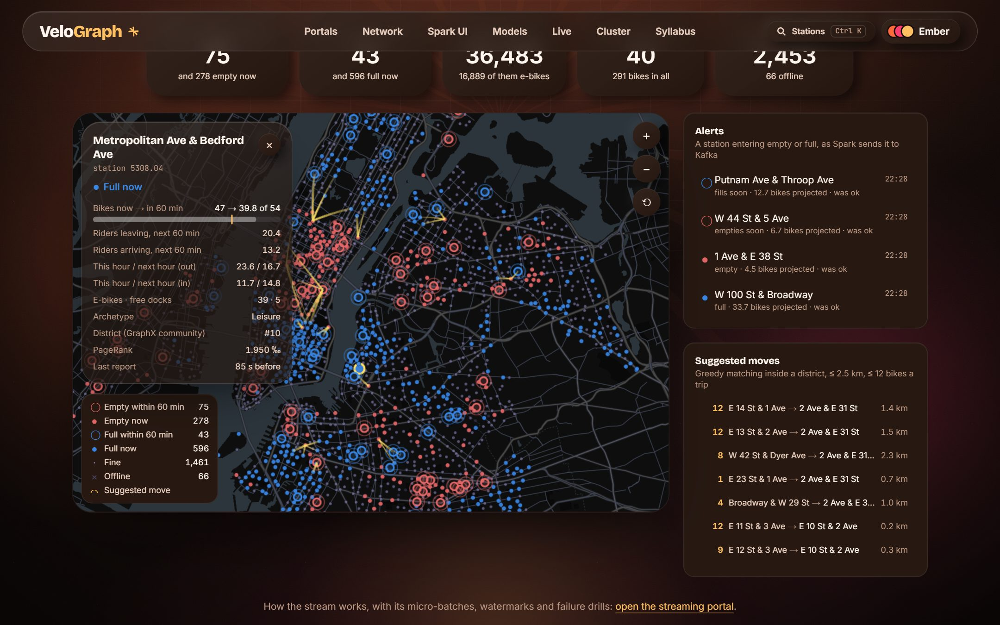
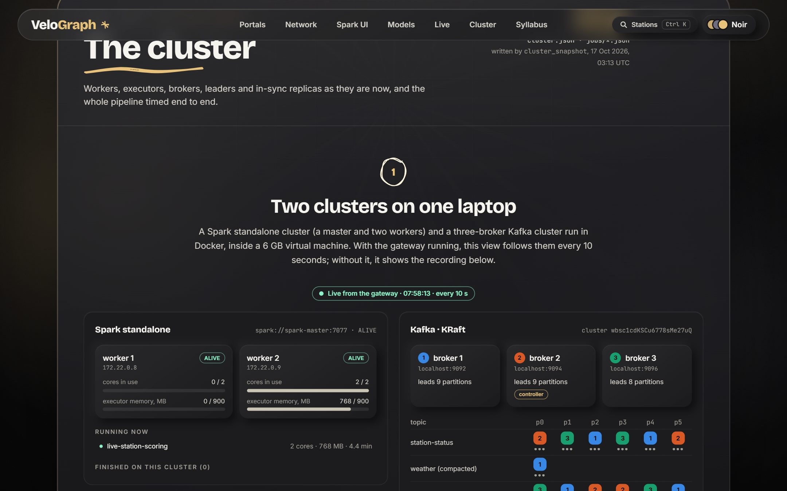
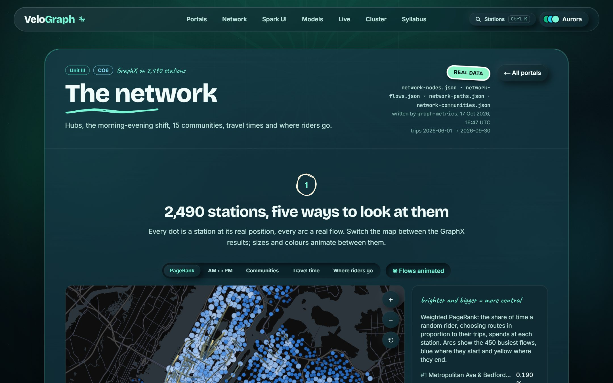
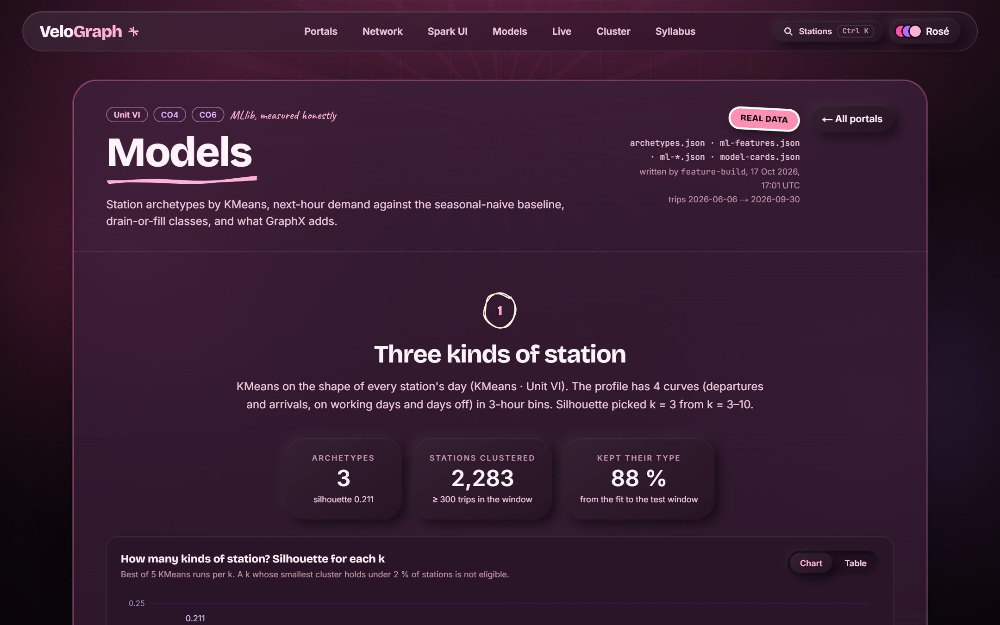
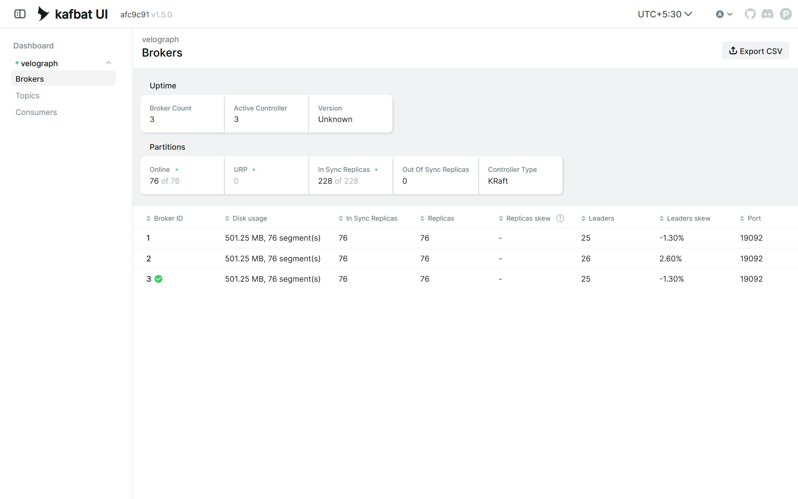
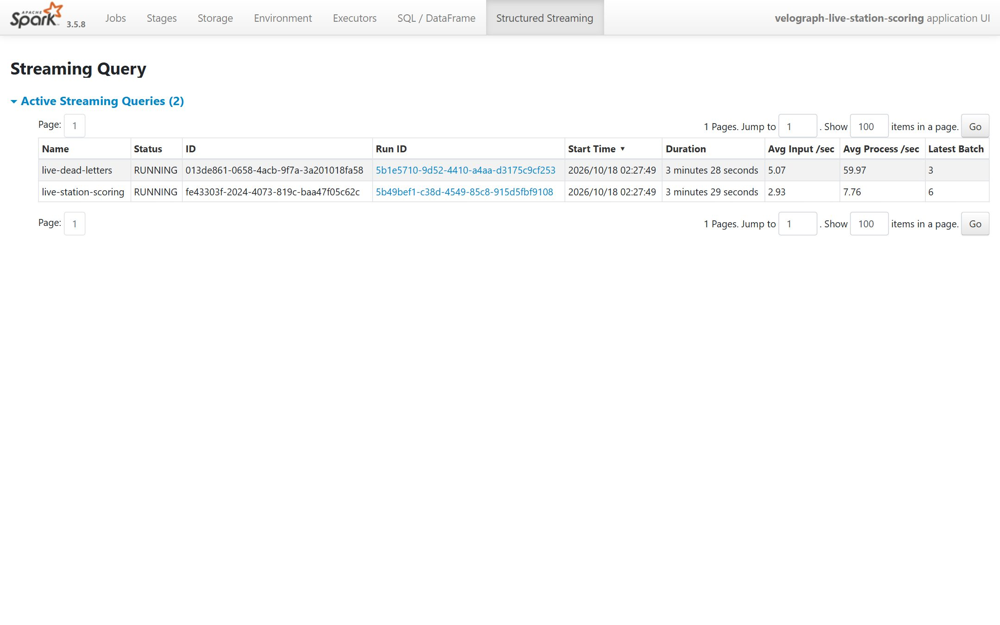

# VeloGraph

**Real-time bike-share intelligence on Apache Spark.** VeloGraph does three things for each of New York's ~2,500
Citi Bike stations:
- forecasts next-hour departures and arrivals;
- fuses them with the live GBFS feed to flag stations about to run empty or full, and suggests rebalancing moves;
- explains the network with GraphX.

INT315 Cluster Computing · Continuous Assessment project · Sayandip Jana · 2026



## What it does

| Layer | Built with | What it shows |
|---|---|---|
| Lake | Spark DataFrames, Parquet | 20.6 M raw trips (Jun–Sep 2026) → bronze → silver (78,098 quarantined, each with a reason) → gold |
| RDD lab | Spark core | `reduceByKey` shuffles 17× less than `groupByKey`; a cached recount is 28× faster |
| Spark SQL | 14 named `.sql` files, Catalyst | when and where New York rides; heavy rain cuts trips by 69 % |
| GraphX | Pregel, label propagation, triangles | 2,490 stations, 1.3 M routes; weighted PageRank in 49 supersteps; 15 districts (modularity 0.788) |
| MLlib | Pipelines, RF / GBT / SVM, KMeans | next-hour demand 6.6 % better than a seasonal naive forecast, with leakage-safe time windows |
| Streaming | Kafka (3 brokers, KRaft) + Structured Streaming | every station re-scored every 30 s on the Spark cluster; broker → map p95 38.2 s |
| Backtest | Spark window functions over the recorded feed | 89.8 % of “empties soon” alerts came true within the hour (6.4 % for stations rated fine) |
| Web | Next.js, deck.gl, ECharts | 11 evidence portals, a live map, ⌘K station search; Lighthouse accessibility 100 |

Every number on the website and in the report is read from the JSON the jobs wrote (`data/serving/`).

## Model results, from a real run

The saved champion models, reloaded from `data/models/` and scored on the September test month:

```powershell
.\scripts\submit.ps1 evaluate-champions -DriverMemory 6g   # about 30 s; also writes serving/model-evaluation.json
```



The models were scored on 1,717,896 station-hours:
- **Departures:** MAE 1.464 against 1.562 for the seasonal naive forecast, 6.3 % better.
- **Arrivals:** MAE 1.476 against 1.566, 5.7 % better.
- **Regime classifier:** macro-F1 0.519, where always guessing "stable" gets 0.283, even though that guess has the
  higher accuracy (0.736 against 0.659): 74 % of station-hours are stable. The confusion matrix is in the output.

The training run's check against the PySpark notebooks is in
[27-terminal-train-champion-log.png](docs/assets/evidence/27-terminal-train-champion-log.png). Each model came within
0.6 % of its notebook, and the job fails beyond 1 %.

## Quick start (Windows, PowerShell)

The demo needs Docker Desktop running and a built fat jar (`cd spark; sbt --batch assembly`).

```powershell
. .\scripts\env.ps1          # JDK 17, Spark, sbt, winutils for this terminal only
.\scripts\doctor.ps1          # checks the toolchain
.\scripts\demo.ps1            # cluster, topics, producer, live scoring, gateway, website (live in ~75 s)
.\scripts\demo.ps1 -Stop      # stops it again (-Down also stops the containers)
```

Then open http://localhost:3000 (the live map is at `/live`). Spark's master UI is on :8080, the scoring job's Spark
UI on :4040, and Kafka UI on :8089.

The batch pipeline, from the raw CSVs to the web exports (about 50 minutes on the full four months):

```powershell
cd python; uv run python -m velograph.ingest.download_trips 202606 202607 202608 202609; cd ..
.\scripts\pipeline.ps1        # every stage, with timings; stops the containers first (16 GB machine)
.\scripts\pipeline.ps1 -Stages graph,ml -WithLabs   # a subset, rerunning the four notebooks too
```

Without the gateway, the website still renders every page from the recorded exports.

## Architecture

```
 Citi Bike trip CSVs ─┐                 ┌─ Spark SQL (14 insights) ─┐
 Open-Meteo weather ──┼─ bronze → silver → gold ─┼─ GraphX (PageRank, districts) ─┼─ serving JSON ─┐
 US holidays ─────────┘                 └─ MLlib (archetypes, champions) ┘               │
                                                                                          ├─ Next.js website
 GBFS live feed → producer → Kafka ×3 → Structured Streaming (score, alerts, moves) → gateway (SSE) ┘
```

- **Batch:** heavy batch jobs run on the host (`local[20]`).
- **Streaming:** the streams run on a Docker Spark cluster (a master and two workers) beside a three-broker Kafka
  cluster.

[docs/ARCHITECTURE.md](docs/ARCHITECTURE.md) has the design; [docs/adr/](docs/adr/) records the decisions.

## Screenshots

| | |
|---|---|
|  |  |
| The live map: every station by state, with alerts and moves | The cluster, live: Spark workers and Kafka brokers |
|  |  |
| GraphX: PageRank and districts | MLlib: models against their baselines |
|  |  |
| Kafka UI: 3 brokers, all partitions in sync | Spark's own Structured Streaming UI |

All 25 screenshots, in the site's six colour themes, are in [docs/assets/evidence/](docs/assets/evidence/)
(`uv run python -m velograph.ops.evidence_shots`), with the two console captures above.

## Repository

```
spark/     Scala 2.12 / Spark 3.5 jobs: etl, gold, rdd, sql, graph, ml, streaming, export (sbt, 77 tests)
python/    ingestion (GBFS producer, recorder, downloads), FastAPI gateway, ops tools, PySpark lab notebooks (30 tests)
web/       Next.js 16 website: evidence portals, live map, station search
infra/     docker-compose: Kafka ×3 (KRaft), Kafka UI, Spark master + 2 workers, history server
scripts/   env, doctor, submit, pipeline, demo, recorder
docs/      ROADMAP, ARCHITECTURE, ADRs, runbook, viva Q&A, report sources, evidence screenshots
```

[docs/RUNBOOK.md](docs/RUNBOOK.md) covers ports, memory, Windows quirks and what to do when something fails.

## Data and licences

Citi Bike trip data and GBFS feeds © NYC Bike Share, LLC, used under the Citi Bike Data License Agreement. Weather by
Open-Meteo.com (CC BY 4.0). Basemap © CARTO, © OpenStreetMap contributors. VeloGraph is an independent student
project, not affiliated with Citi Bike or Lyft.
