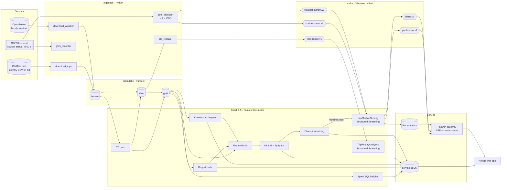
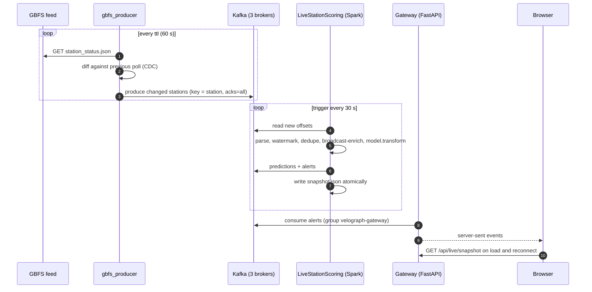

# VeloGraph — Architecture

> **Status:** v1 design, 14 Oct 2026 · INT315 Cluster Computing CA project
> This is the blueprint. When the implementation diverges, update this file in the same commit and add an ADR.

1. [Problem & goals](#1-problem--goals)
2. [System overview](#2-system-overview)
3. [Runtime topologies & resource budget](#3-runtime-topologies--resource-budget)
4. [Data sources](#4-data-sources)
5. [Data lake](#5-data-lake)
6. [Batch jobs](#6-batch-jobs)
7. [Graph analytics (GraphX)](#7-graph-analytics-graphx)
8. [Machine learning (MLlib)](#8-machine-learning-mllib)
9. [Streaming (Kafka + Structured Streaming)](#9-streaming-kafka--structured-streaming)
10. [Serving layer & contracts](#10-serving-layer--contracts)
11. [Web experience](#11-web-experience)
12. [Configuration, ports & environments](#12-configuration-ports--environments)
13. [Quality strategy](#13-quality-strategy)
14. [Licensing & attribution](#14-licensing--attribution)
15. [Decision log](#15-decision-log)

---

## 1. Problem & goals

**Problem.** Demand in a dock-based bike-share system is directional. Between 8 and 9 am riders leave residential
stations and pile into office districts; in the evening the flow reverses. Stations run empty (lost rides) or full
(riders cannot return bikes). Operators rebalance with vans and rider incentives, mostly *after* the problem appears.

**Goal.** For each of NYC's ~2,500 Citi Bike stations, every 30 seconds:

1. forecast departures and arrivals for the next 60 minutes (MLlib);
2. combine them with live inventory from the GBFS feed (Kafka → Structured Streaming);
3. flag **empty-risk / full-risk** stations and classify their **flow regime** (draining / stable / filling);
4. propose **rebalancing moves** between surplus and deficit stations inside the same graph community (GraphX);
5. explain the network: hubs, communities, morning-vs-evening attraction, flow imbalance.

**Success criteria**

| Area | Target |
|---|---|
| Data | Jun–Sep 2026 trips (~20M rows) through bronze → silver → gold, with a data-quality report |
| Demand model | Beats the seasonal-naive baseline on Sep 2026 MAE (target ≥ 10 %) |
| Regime classifier | Macro-F1 and confusion matrix reported; beats the majority-class baseline |
| Graph value | Ablation measures what GraphX features add (reported honestly, positive or not) |
| Streaming | Live feed → snapshot latency p95 < 90 s; survives one broker failure; resumes from checkpoint |
| UX | Every on-screen number traces to a job export; fully usable offline |

**Non-goals (v1):** authentication, multiple cities, deep learning, street-level routing, production SLAs.

## 2. System overview



**The live loop, every 30 seconds**



**Polyglot by design.** Scala owns ETL, GraphX (Scala-only API), production training and streaming. PySpark owns the
ML Lab, because Unit VI asks for "Spark ML algorithms using pyspark". Python also owns ingestion and the gateway (best
HTTP/Kafka ecosystem), and TypeScript owns the UI. Spark ML persistence is language-neutral, so models move between
Scala and Python without glue.

## 3. Runtime topologies & resource budget

Same code in every mode; only configuration changes.

| Mode | Spark | Kafka | Used for |
|---|---|---|---|
| **dev** | host `local[*]` (`C:\spark` 3.5.8, JDK 17) | Docker, 3 brokers | building, tests, heavy batch ETL (native NTFS IO, 20 of 24 threads) |
| **cluster** | Docker standalone: 1 master + 2 workers (+ history server) | Docker, 3 brokers | streaming, distributed GraphX/ML runs, Spark UIs for the viva |
| **offline** | — | — | website from static exports + recorded live replay |

Docker bind mounts on Windows are slow for multi-GB scans, so bronze/silver ETL runs in dev mode and the cluster reads
the compact gold Parquet (hundreds of MB) through the shared `./data` mount.

**RAM budget** — 16 GB host. `%USERPROFILE%\.wslconfig` caps the Docker VM at 6 GB (`memory=6GB`, `swap=8GB`;
`docker info` reports 5.8 GB), so the cluster is sized for that ([ADR 009](adr/009-docker-vm-6gb-budget.md)).
`mem_limit` values are hard caps; the last column was measured on 15 Oct 2026.

| Container | JVM settings | `mem_limit` | Measured at idle |
|---|---|---|---|
| kafka-1..3 (broker + controller) | heap 256 MB each | 640 MB each | ≈ 395 MB each |
| kafka-ui | heap ≤ 224 MB | 448 MB | ≈ 350 MB |
| spark-master (+ client-mode driver) | daemon 256 MB, driver 640 MB | 1,280 MB | ≈ 255 MB |
| spark-worker-1..2 | daemon 256 MB, one 768 MB executor with 2 cores | 1,408 MB each | ≈ 160 MB each |
| spark-history (on demand) | daemon 256 MB | 640 MB | — |
| **Total, history off** | | | **≈ 2.1 GB idle** |

A running job adds its driver (≤ 640 MB heap) and one executor per worker (768 MB heap each). Raising `memory=` in
`.wslconfig` to 8 GB would add headroom, but that machine-wide change is the user's call. Host dev mode runs heavy
jobs with `--driver-memory 6g` while the Spark containers are stopped.

## 4. Data sources

| Source | Content | Access | Volume | Licence |
|---|---|---|---|---|
| Citi Bike System Data | trips: `ride_id, rideable_type, started_at, ended_at, start/end_station_{name,id}, start/end_{lat,lng}, member_casual` | `https://s3.amazonaws.com/tripdata/2026{06..09}-citibike-tripdata.zip` (uncompressed zips of ~195 MB CSV parts) | ≈ 4.0 GB CSV, ≈ 20M trips | NYC Bike Share Data License Agreement (attribution) |
| GBFS 2.3 (Citi Bike, operated by Lyft) | `station_status` (bikes, e-bikes, docks; `ttl` 60 s) and `station_information` (name, lat/lon, capacity, `short_name`) | `https://gbfs.lyft.com/gbfs/2.3/bkn/en/*.json`, no key | 2,519 stations (14 Oct 2026) | same licence |
| Open-Meteo | hourly archive (ERA5) and current/forecast weather for NYC | `archive-api.open-meteo.com`, `api.open-meteo.com`, no key, non-commercial | ~3k hourly rows | CC BY 4.0 |
| US federal holidays | Fri 19 Jun, Fri 3 Jul (observed), Mon 7 Sep, Mon 12 Oct 2026 | static CSV in the repo | — | public domain |

**Join key:** trip `start_station_id` / `end_station_id` (e.g. `5114.08`) equals GBFS `short_name`. The GBFS
`station_id` is a UUID used only by the live feed. Scope: the NYC monthly files (cross-river Jersey City trips inside
them are kept); JC-only files are out of scope for v1.

## 5. Data lake

Root `${VELOGRAPH_DATA_ROOT}` (default `./data`):

```
data/
  raw/          citibike/<yyyymm>/*.csv, manifest.json · weather/*.json · gbfs/station_information_<date>.json
                gbfs_recordings/<date>/*.jsonl.gz
  lake/
    bronze/     trips (partition ym) · weather_hourly
    silver/     trips (partition start_date) · trips_quarantine (partition reason) · stations · weather_hourly
    gold/       station_hour (partition date) · route_edges · station_profiles · ml_features (partition split)
    graph/      station_metrics · communities · flows_top · landmark_paths
  models/       <model>/<version>/ (Spark ML PipelineModel) + model-card.json
  stream/       predictions (partition date) · trip_metrics
  checkpoints/  <streaming job>/
  serving/      *.json UI contracts · jobs/*.json · live/snapshot.json
  spark-events/ event logs for the history server
```

**silver.trips**

| Column | Type | Notes |
|---|---|---|
| ride_id | string | dedupe key |
| rideable_type | string | `classic_bike` / `electric_bike` |
| started_at, ended_at | timestamp | NYC local time (session time zone `America/New_York`) |
| start_station_id, end_station_id | string | GBFS `short_name`; nullable (e-bikes can end off-dock) |
| start_station_name, end_station_name | string | |
| start_lat, start_lng, end_lat, end_lng | double | |
| member_casual | string | `member` / `casual` |
| duration_s | int | ended − started |
| distance_m | double | haversine start → end, built-in functions (no UDF) |
| speed_kmh | double | distance / duration |
| is_round_trip | boolean | start = end station |
| start_date | date | partition column |
| start_hour, dow | int | |

Quarantine reason codes: `NON_POSITIVE_DURATION`, `DURATION_LT_60S`, `DURATION_GT_4H`, `COORD_OUT_OF_BBOX`,
`IMPOSSIBLE_SPEED` (> 45 km/h), `DUPLICATE_RIDE_ID`. Trips without a station are *kept* and flagged; station-level
tables simply filter them.

**silver.stations** — `station_id, gbfs_station_id, name, lat, lon, capacity, region_id, first_seen, last_seen,
trips_out, trips_in, in_gbfs`.

**gold.station_hour** — complete panel of stations × hours with zero fill (≈ 2.3k × 2,928 ≈ 6.7M rows):
`station_id, ts_hour, date (partition), hour, dow, is_weekend, is_holiday, departures, arrivals, net_flow
(= arrivals − departures), dep_member, dep_casual, dep_ebike, arr_ebike, avg_dep_duration_s, temp_c,
apparent_temp_c, precip_mm, wind_kmh, humidity_pct, cloud_pct, weather_code`.

**gold.route_edges** — `src_id, dst_id, trips, trips_am_peak (weekday 07–10), trips_pm_peak (weekday 16–19),
trips_weekend, median_duration_s, member_share, ebike_share`.

**gold.station_profiles** — `station_id, window_id, how (hour-of-week 0..167), dep_mean, arr_mean, dep_std, n_weeks`
(holidays excluded).

## 6. Batch jobs

Scala unless noted. Every job extends `SparkJob` and writes `serving/jobs/<job>.json` (start, end, duration, rows in
and out, Spark app id), which feeds the pipeline timeline and the report's benchmark table.

| Job | Input → output | Spark concepts on show | Syllabus |
|---|---|---|---|
| BronzeIngestJob | raw CSV → bronze.trips | explicit schema, `input_file_name`, partitioned Parquet | U1, U4 |
| SilverTripsJob | bronze → silver.trips + quarantine + `dq-report.json` | column expressions, accumulators, dedupe | U3, U4 |
| SilverStationsJob | silver.trips + GBFS info → silver.stations | aggregations, `percentile_approx`, joins | U4 |
| SilverWeatherJob | raw JSON → silver.weather_hourly | `arrays_zip` + `explode` | U4 |
| GoldStationHourJob | silver → gold.station_hour | cross-join panel, broadcast hints, partition pruning | U4, CO5 |
| GoldRoutesJob | silver → gold.route_edges | conditional aggregates | U4 |
| RddFundamentalsJob | raw CSV → `rdd-fundamentals.json` | textFile, map/filter/flatMap, reduceByKey vs groupByKey, join, persist levels, broadcast, accumulators, `toDebugString`, RDD → DataFrame | U1, U3, U4 |
| InsightsJob | silver + gold → `insights/*.json` | temp views, 14 named `.sql` files: joins, groupBy, orderBy, window functions, `LIKE` / `RLIKE` | U4 |
| GraphMetricsJob | route_edges + stations → `lake/graph/*`, `network-*.json` | see §7 | U3, CO6 |
| StationArchetypesJob | gold.station_hour → archetypes, `archetypes.json` | KMeans, ClusteringEvaluator, PCA | U6, CO4 |
| FeatureBuildJob | gold + graph + archetypes → gold.ml_features | window functions, trailing-window encodings, SQLTransformer | U3, CO4 |
| *ML Lab (PySpark notebooks)* | gold.ml_features → leaderboards, ablation, heat map | see §8 | U6, CO4 |
| TrainChampionJob | gold.ml_features → `models/*`, model cards | Pipeline, PipelineModel persistence | CO4 |
| ServingExportJob | lake → `serving/*.json` | small coalesced, schema-versioned writes | CO5 |

## 7. Graph analytics (GraphX)

**Graph.** Vertices are stations: `VertexId = xxhash64(station_id)` (uniqueness asserted at build time) with
`StationAttr(id, name, lat, lon, capacity)`. Edges are directed routes with
`RouteAttr(trips, amTrips, pmTrips, weekendTrips, medianDurationS)`. Round trips (self-loops) count towards strength
but are removed for triangles and communities. Partitioning `EdgePartition2D`; Kryo via
`GraphXUtils.registerKryoClasses`.

| # | Algorithm | Implementation | Output and meaning |
|---|---|---|---|
| G1 | Weighted PageRank | custom Pregel; rank flows along edges ∝ trips / out-strength; damping 0.85, tol 1e-6 | `pagerank_w`: where riders end up, volume-weighted |
| G2 | PageRank, built-in | `graph.pageRank(tol)` on the unweighted route graph | `pagerank_u`: compared with G1 (Spearman ρ) to show why weights matter |
| G3 | Morning vs evening | G1 on weekday 07–10 and 16–19 subgraphs | `pr_am`, `pr_pm`, `pr_shift`: office vs residential signature |
| G4 | Strength & imbalance | `aggregateMessages`, `outerJoinVertices` | `in_strength`, `out_strength`, `net_strength`, `imbalance_ratio` |
| G5 | Communities | weighted label propagation (Pregel, deterministic ties) on the strong-edge subgraph + built-in `LabelPropagation` baseline; modularity Q | `community_id`: rebalancing zones |
| G6 | Components | `connectedComponents`, `stronglyConnectedComponents(10)` | isolated or one-way stations; data health |
| G7 | Cohesion | `TriangleCount` on the undirected strong graph → local clustering coefficient | `triangles`, `clustering_coef` |
| G8 | Paths | `ShortestPaths` (hops) to the top-10 hubs; Pregel SSSP weighted by median ride time from 20 landmarks | travel-time isochrones in the UI |
| G9 | Personalized PageRank | `personalizedPageRank(src)` per landmark | "where do riders from here go?" |
| G10 | Operator tour | `subgraph`, `mask`, `reverse`, `mapVertices`, `mapEdges`, `groupEdges`, `degrees`, `triplets` | documented for Unit III "GraphX operations" |

**Strong-edge subgraph** (communities, triangles): keep (u, v) when trips ≥ 20 and v is among u's top-10
destinations; undirected weight = trips(u→v) + trips(v→u).

Outputs land in `lake/graph/station_metrics` (one row per station, all metrics). They are joined into the ML features
(CO6 → CO4) and exported for the Network page.

## 8. Machine learning (MLlib)

### 8.1 Framing

- Unit of prediction: (station, hour).
- Targets: `departures` and `arrivals` (counts) → regression; `regime` ∈ {0 draining, 1 stable, 2 filling}, derived
  from `net_flow` against a capacity-aware threshold τ chosen from the data → classification.
- Live use: next-60-minute net flow = (1 − f)·net̂(h₀) + f·net̂(h₀ + 1), where f = minutes elapsed in the current hour
  / 60. Projected bikes = bikes now + that net flow, clamped to [0, capacity].

### 8.2 Leakage-safe windows

| Window | Dates (2026) | Purpose |
|---|---|---|
| Profile-A | 6 Jun – 31 Jul (8 weeks) | hour-of-week profiles for fit rows |
| Fit | 1 – 31 Aug | training; 25–31 Aug doubles as the validation week for tuning |
| Profile-B | 7 Jul – 31 Aug (8 weeks) | profiles for test rows |
| Test | 1 – 30 Sep | final evaluation, never used for tuning |
| Profile-L | trailing 8 weeks before go-live | live scoring |

Every profile window ends before the window it feeds; `FeatureBuildJob` asserts this.

### 8.3 Features

| Group | Features |
|---|---|
| Calendar | hour as sin/cos, day-of-week one-hot, is_weekend, is_holiday |
| Weather | temp_c, apparent_temp_c, precip_mm, is_raining, wind_kmh, humidity_pct, cloud_pct |
| Station | capacity, lat, lon, archetype (one-hot) |
| Graph (GraphX) | pagerank_w, pr_am, pr_pm, pr_shift, in/out strength, imbalance_ratio, clustering_coef, community (indexed for trees, one-hot for linear models) |
| Profile | prof_dep_mean, prof_arr_mean, prof_dep_std for station × hour-of-week, trailing window |

The feature dictionary is exported to `serving/ml-features.json`.

### 8.4 Algorithms & metrics

| Task | Algorithms | Metrics |
|---|---|---|
| Regression (departures, arrivals) | baselines: global mean, seasonal naive (= profile mean); LinearRegression (elastic net), DecisionTreeRegressor, RandomForestRegressor, GBTRegressor | R², RMSE, MAE; error by hour and archetype; residual plots |
| Classification (regime) | baseline: majority class; LogisticRegression (multinomial), DecisionTree, RandomForest, NaiveBayes (Gaussian), LinearSVC via OneVsRest; class weights via `weightCol` | confusion matrix, accuracy, macro-F1, per-class precision/recall |
| Clustering (archetypes) | KMeans, k = 3..10 chosen by silhouette; PCA 2-D for display | silhouette, cluster sizes, centroid profiles |
| Correlation | Pearson + Spearman (`ml.stat.Correlation`) | heat map |
| Ablation | champion with/without graph features, with/without profiles | Δ MAE, Δ R² |

### 8.5 Ownership

- The **PySpark ML Lab** notebooks run every algorithm above on `gold.ml_features` and write the leaderboards. They are
  the source of truth for the comparison.
- The Scala **TrainChampionJob** retrains the selected algorithm and parameters (declared in config), saves
  `PipelineModel`s, and asserts its test metrics match the lab within ±1 %.
- Each model card records algorithm, parameters, features, windows, metrics, training rows, Spark version, git SHA and
  training time.

## 9. Streaming (Kafka + Structured Streaming)

### 9.1 Kafka cluster

Three nodes in KRaft combined mode (broker + controller), no ZooKeeper. `default.replication.factor=3`,
`min.insync.replicas=2`, `auto.create.topics.enable=false`. Listeners: `INTERNAL` (container network,
`kafka-N:19092`), `EXTERNAL` (host, `localhost:9092/9094/9096`), `CONTROLLER` (`:9093`).

### 9.2 Topics

| Topic | Key | Partitions | Retention / cleanup | Producer → consumers |
|---|---|---|---|---|
| `velograph.gbfs.station-status.v1` | station `short_name` | 6 | 24 h, delete | gbfs_producer → LiveStationScoring |
| `velograph.weather.current.v1` | `nyc` | 1 | compact | gbfs_producer → LiveStationScoring (batch read of the latest value) |
| `velograph.trips.replay.v1` | start station | 6 | 6 h, delete | trip_replayer → TripReplayAnalytics |
| `velograph.trip-metrics.v1` | window + station | 3 | 6 h, delete | TripReplayAnalytics → gateway |
| `velograph.predictions.v1` | station | 6 | 24 h, delete | LiveStationScoring → gateway |
| `velograph.alerts.v1` | station | 3 | 7 d, delete | LiveStationScoring → gateway (`velograph-gateway` group), CLI consumer demo |
| `velograph.dlq.v1` | source | 1 | 7 d, delete | any producer or consumer, for poison messages |

Messages are JSON with `schema` and `v` fields. Event time is the GBFS `last_reported` (epoch seconds).
Topic names use `.` between segments and `-` inside them, never `_`: Kafka metric names treat `.` and `_` alike,
so mixing them can make two topics' metrics collide.

### 9.3 Producers & ingestion patterns

| Pattern | Where | Notes |
|---|---|---|
| API polling → stream (pull-to-push) | gbfs_producer | honours `ttl`; exponential backoff on errors |
| Change data capture | gbfs_producer | publishes only stations whose (last_reported, bikes, e-bikes, docks) changed |
| Batch → stream replay | trip_replayer | event-time ordered, speed factor (default ×60), preserves inter-arrival gaps |
| Record & replay | gbfs_recorder, `gbfs_producer --source recorded` | offline demo + live backtest |
| Dead-letter queue | all | malformed payloads → DLQ with error and raw bytes |

Producer settings: `acks=all`, `enable.idempotence=true`, `compression.type=lz4`, `linger.ms=20`, delivery callbacks
with metrics.

### 9.4 Structured Streaming jobs

**LiveStationScoringJob** (Scala)

1. `readStream.format("kafka")` on station_status (`startingOffsets=latest`, `maxOffsetsPerTrigger` cap) → `from_json`
   with an explicit schema.
2. `event_time = timestamp_seconds(last_reported)`; `withWatermark("event_time", "10 minutes")`;
   `dropDuplicatesWithinWatermark("station_id", "last_reported")`.
3. `foreachBatch`, trigger 30 s:
   - latest state per station within the batch;
   - broadcast-join static features: stations ⨝ graph metrics ⨝ archetypes ⨝ profiles for the current and next
     hour-of-week;
   - latest weather from a batch read of the compacted weather topic;
   - `PipelineModel.transform` → departures/arrivals for h₀ and h₀ + 1 → 60-min net flow, projected bikes, risk
     (`EMPTY_RISK` if projected < max(2, 10 % of capacity), `FULL_RISK` if free docks would drop below the same
     margin), regime;
   - rebalancing: greedy deficit ↔ surplus matching inside each community, ≤ 2.5 km, ≤ 12 bikes per move (driver-side
     on ≤ 2.5k rows — a deliberate, bounded collect);
   - sinks: Kafka predictions (all) and alerts (risk ≠ OK and changed), Parquet `stream/predictions` (append), and an
     atomic `serving/live/snapshot.json` (write temp, then rename).
4. Checkpoint in `checkpoints/live-station-scoring`; a restart resumes from the stored offsets.

**TripReplayAnalyticsJob** (Scala) — reads `trips.replay`; event time = `started_at`; 15-minute watermark; tumbling
15-minute departures per station; sliding 60/15-minute system totals by member/casual and e-bike; a late-row counter
via `observe()`; sinks to Kafka `trip-metrics` and the console. It demonstrates output modes (update vs append), the
state store, late data and triggers.

### 9.5 Guarantees

- Kafka → Spark: offsets live in the checkpoint, so processing is exactly-once with respect to state. The Kafka sink
  is at-least-once, so consumers dedupe by (station, event_time). The snapshot file is replaced atomically.
- Losing one broker is tolerated: RF 3 with min ISR 2 and `acks=all`.

## 10. Serving layer & contracts

Static exports are written to `data/serving/` and copied into `web/public/data/` by `scripts/sync-web-data.ps1`.

| File | Producer | Page |
|---|---|---|
| `overview.json`, `hero-trips.json` (one real evening, sampled) | ServingExportJob | Home |
| `insights/<id>.json` | InsightsJob | Insights |
| `rdd-fundamentals.json`, `dq-report.json`, `jobs/*.json` | batch jobs | Cluster |
| `network-nodes.json`, `network-flows.json`, `network-communities.json`, `network-paths.json` | GraphMetricsJob | Network |
| `archetypes.json`, `ml-regression.json`, `ml-classification.json`, `ml-ablation.json`, `ml-correlation.json`, `model-cards.json` | ML Lab + jobs | Models |
| `live-replay/*.json` | recorder → exporter | Live (offline mode) |

Every file uses one envelope:

```json
{
  "meta": {
    "schema": "velograph.network-nodes", "version": 1,
    "generatedAt": "2026-10-17T10:00:00Z", "job": "GraphMetricsJob",
    "source": { "from": "2026-06-01", "to": "2026-09-30" }, "rows": 2491
  },
  "data": []
}
```

**Gateway** (FastAPI, `python/velograph/api`)

| Endpoint | Purpose |
|---|---|
| `GET /api/health` | liveness + Kafka and Spark reachability |
| `GET /api/live/snapshot` | latest `snapshot.json` |
| `GET /api/live/stream` | SSE of predictions and alerts from Kafka (consumer group `velograph-gateway`) |
| `GET /api/cluster` | Spark master `/json` (workers, cores, memory, apps) + Kafka AdminClient metadata (brokers, partitions, leaders, ISR) |
| `POST /api/sql` *(stretch)* | read-only Spark SQL on gold tables, LIMIT 500, 20 s timeout |

## 11. Web experience

**Stack:** Next.js 16 (App Router, server components), React 19, TypeScript strict, Tailwind CSS 4, shadcn/ui (Radix),
motion, deck.gl 9 + MapLibre 6 via react-map-gl 8 (CARTO Dark Matter basemap, no key), ECharts 6, zod.

| Route | Purpose | Signature moment |
|---|---|---|
| `/` | Story + headline KPIs | night-time animated trips over NYC (TripsLayer) |
| `/live` | Operations | pulsing risk halos, alert ticker, suggested moves drawn as arcs |
| `/network` | GraphX | AM ↔ PM PageRank morph slider, communities, travel-time isochrones |
| `/models` | MLlib | leaderboards vs baselines, confusion matrix, ablation, archetype profiles, heat map |
| `/insights` | Spark SQL | insight cards with "View SQL" |
| `/cluster` | Cluster computing | live topology: 3 brokers (leaders/ISR), Spark master + workers, streaming health, job timeline |
| `/syllabus` | Traceability | unit/CO → feature → evidence |

**Design language — "Nocturne".** A dark-first operations aesthetic for a living city: near-black blue canvas,
hairline borders, glass only over maps, one accent per meaning (supply, empty-risk, full-risk, graph, healthy), Geist +
Geist Mono with tabular numerals, 150–300 ms motion, `prefers-reduced-motion` respected. The final palette is
validated for contrast and colour-blind safety with the `dataviz` skill in P6.

**States.** Every component has loading, empty, error and offline states. When the gateway is unreachable a banner
appears and the Live page switches to recorded replay automatically.

## 12. Configuration, ports & environments

Configuration precedence: `spark/src/main/resources/application.conf` (defaults) ← `conf/<mode>.conf` ←
`VELOGRAPH_*` environment variables.

Dev-mode Spark settings: `spark.master=local[20]`, `spark.sql.shuffle.partitions=96`,
`spark.sql.session.timeZone=America/New_York`, `spark.serializer=KryoSerializer`, `spark.eventLog.enabled=true`
(→ `data/spark-events`).

| Port | Service |
|---|---|
| 3000 | Next.js |
| 8000 | FastAPI gateway |
| 8080 / 7077 | Spark master UI / RPC |
| 8081, 8082 | Spark worker UIs |
| 4040+ | Spark driver UIs |
| 18080 | Spark history server |
| 9092, 9094, 9096 | Kafka external listeners |
| 8089 | Kafka UI |

`scripts/env.ps1` sets `JAVA_HOME` (JDK 17), `SPARK_HOME=C:\spark`, `HADOOP_HOME=C:\hadoopsetup\hadoop-3.2.4` and
`PYSPARK_PYTHON` (project venv) for the current PowerShell session only.

## 13. Quality strategy

- **Scala:** ScalaTest with a shared local SparkSession; tests for DQ rules, haversine, panel zero-fill, window
  boundaries (no-leakage assertions), weighted PageRank and LPA on toy graphs with known answers, triangle counts and
  the rebalancing matcher.
- **Python:** pytest for CDC diffing, replay pacing and gateway endpoints.
- **Contracts:** `scripts/validate_exports.py` checks every serving envelope and its required fields; the web app parses
  with zod.
- **Reproducibility:** fixed seeds, ML windows in config, exports stamped with source range and git SHA.
- **Observability:** Spark event logs (history server), per-job report JSON, producer and stream metrics logged every
  minute.

## 14. Licensing & attribution

Citi Bike trip data and GBFS feeds © NYC Bike Share, LLC, used under its Data License Agreement. VeloGraph is an
independent student project, not affiliated with Citi Bike or Lyft, and uses no Citi Bike branding. Weather data by
Open-Meteo.com (CC BY 4.0). Basemap © CARTO, © OpenStreetMap contributors.

## 15. Decision log

| ADR | Decision | Reason |
|---|---|---|
| 001 | Bike-share (VeloGraph) over air quality or cricket | natural large graph; a live feed with the same semantics as the training data; public data without login |
| 002 | Scala core + PySpark lab | GraphX is Scala-only (CO6); Unit VI explicitly asks for PySpark; ML persistence is language-neutral |
| 003 | Spark 3.5.8 / Scala 2.12 / JDK 17 | matches the installed distribution and the course; Spark 3.5 supports Java 8/11/17 |
| 004 | Kafka 4.3 KRaft with 3 nodes | modern ZooKeeper-free architecture; RF 3 enables a live failover demo |
| 005 | Heavy ETL on host, streaming on the Docker cluster | slow bind-mount IO on Windows; 16 GB RAM |
| 006 | Static JSON contracts + FastAPI gateway | the site works offline and can be deployed statically; only live features need the backend |
| 007 | Time-based windows + trailing profiles | prevents leakage and mirrors production |
| 008 | sbt 1.12 rather than sbt 2.0 | plugin and IntelliJ stability |
| [009](adr/009-docker-vm-6gb-budget.md) | Size the Docker cluster for a 6 GB VM | `.wslconfig` caps the VM at 6 GB; changing it is the user's call |
| [010](adr/010-kafka-topic-naming.md) | Topic names use hyphens, never underscores | Kafka metric names treat `.` and `_` alike |
