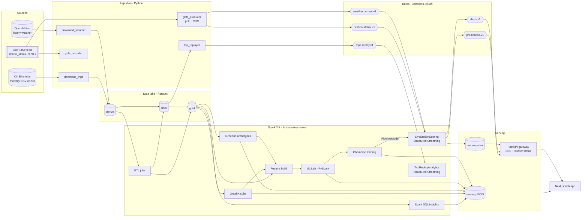
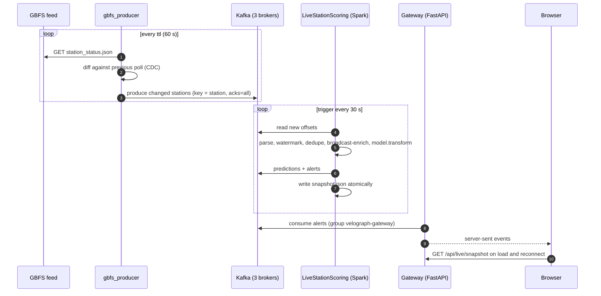

# VeloGraph — Architecture

> **Status:** v1 design, 14 Oct 2026 · INT315 Cluster Computing CA project
> This is the blueprint. When the implementation diverges, update this file in the same commit and add an ADR.

1. [Problem & goals](#1-problem--goals)
2. [System overview](#2-system-overview)
3. [Runtime topologies & resource budget](#3-runtime-topologies--resource-budget)
4. [Data sources](#4-data-sources)
5. [Data lake](#5-data-lake)
6. [Batch jobs](#6-batch-jobs)
7. [Graph analytics (GraphX)](#7-graph-analytics-graphx)
8. [Machine learning (MLlib)](#8-machine-learning-mllib)
9. [Streaming (Kafka + Structured Streaming)](#9-streaming-kafka--structured-streaming)
10. [Serving layer & contracts](#10-serving-layer--contracts)
11. [Web experience](#11-web-experience)
12. [Configuration, ports & environments](#12-configuration-ports--environments)
13. [Quality strategy](#13-quality-strategy)
14. [Licensing & attribution](#14-licensing--attribution)
15. [Decision log](#15-decision-log)

---

## 1. Problem & goals

**Problem.** Demand in a dock-based bike-share system is directional. Between 8 and 9 am riders leave residential
stations and pile into office districts; in the evening the flow reverses. Stations run empty (lost rides) or full
(riders cannot return bikes). Operators rebalance with vans and rider incentives, mostly *after* the problem appears.

**Goal.** For each of NYC's ~2,500 Citi Bike stations, every 30 seconds:

1. forecast departures and arrivals for the next 60 minutes (MLlib);
2. combine them with live inventory from the GBFS feed (Kafka → Structured Streaming);
3. flag **empty-risk / full-risk** stations and classify their **flow regime** (draining / stable / filling);
4. propose **rebalancing moves** between surplus and deficit stations inside the same graph community (GraphX);
5. explain the network: hubs, communities, morning-vs-evening attraction, flow imbalance.

**Success criteria**

| Area | Target |
|---|---|
| Data | Jun–Sep 2026 trips (~20M rows) through bronze → silver → gold, with a data-quality report |
| Demand model | Beats the seasonal-naive baseline on Sep 2026 MAE (target ≥ 10 %) |
| Regime classifier | Macro-F1 and confusion matrix reported; beats the majority-class baseline |
| Graph value | Ablation measures what GraphX features add (reported honestly, positive or not) |
| Streaming | Live feed → snapshot latency p95 < 90 s; survives one broker failure; resumes from checkpoint |
| UX | Every on-screen number traces to a job export; fully usable offline |

**Non-goals (v1):** authentication, multiple cities, deep learning, street-level routing, production SLAs.

## 2. System overview



**The live loop, every 30 seconds**



**Polyglot by design.** Scala owns ETL, GraphX (Scala-only API), production training and streaming. PySpark owns the
ML Lab, because Unit VI asks for "Spark ML algorithms using pyspark". Python also owns ingestion and the gateway (best
HTTP/Kafka ecosystem), and TypeScript owns the UI. Spark ML persistence is language-neutral, so models move between
Scala and Python without glue.

## 3. Runtime topologies & resource budget

Same code in every mode; only configuration changes.

| Mode | Spark | Kafka | Used for |
|---|---|---|---|
| **dev** | host `local[*]` (`C:\spark` 3.5.8, JDK 17) | Docker, 3 brokers | building, tests, heavy batch ETL (native NTFS IO, 20 of 24 threads) |
| **cluster** | Docker standalone: 1 master + 2 workers (+ history server) | Docker, 3 brokers | streaming, distributed GraphX/ML runs, Spark UIs for the viva |
| **offline** | — | — | website from static exports + recorded live replay |

Docker bind mounts on Windows are slow for multi-GB scans, so bronze/silver ETL runs in dev mode and the cluster reads
the compact gold Parquet (hundreds of MB) through the shared `./data` mount.

**RAM budget** — 16 GB host. `%USERPROFILE%\.wslconfig` caps the Docker VM at 6 GB (`memory=6GB`, `swap=8GB`;
`docker info` reports 5.8 GB), so the cluster is sized for that ([ADR 009](adr/009-docker-vm-6gb-budget.md)).
`mem_limit` values are hard caps; the last column was measured on 15 Oct 2026.

| Container | JVM settings | `mem_limit` | Measured at idle |
|---|---|---|---|
| kafka-1..3 (broker + controller) | heap 256 MB each | 640 MB each | ≈ 395 MB each |
| kafka-ui | heap ≤ 224 MB | 448 MB | ≈ 350 MB |
| spark-master (+ client-mode driver) | daemon 256 MB, driver 640 MB | 1,280 MB | ≈ 255 MB |
| spark-worker-1..2 | daemon 256 MB, one 768 MB executor with 2 cores | 1,408 MB each | ≈ 160 MB each |
| spark-history (on demand) | daemon 256 MB | 640 MB | — |
| **Total, history off** | | | **≈ 2.1 GB idle** |

A running job adds its driver (≤ 640 MB heap) and one executor per worker (768 MB heap each). Raising `memory=` in
`.wslconfig` to 8 GB would add headroom, but that machine-wide change is the user's call. Host dev mode runs heavy
jobs with `--driver-memory 6g` while the Spark containers are stopped.

## 4. Data sources

| Source | Content | Access | Volume | Licence |
|---|---|---|---|---|
| Citi Bike System Data | trips: `ride_id, rideable_type, started_at, ended_at, start/end_station_{name,id}, start/end_{lat,lng}, member_casual` | `https://s3.amazonaws.com/tripdata/2026{06..09}-citibike-tripdata.zip` (uncompressed zips of ~195 MB CSV parts) | ≈ 4.0 GB CSV, ≈ 20M trips | NYC Bike Share Data License Agreement (attribution) |
| GBFS 2.3 (Citi Bike, operated by Lyft) | `station_status` (bikes, e-bikes, docks; `ttl` 60 s) and `station_information` (name, lat/lon, capacity, `short_name`) | `https://gbfs.lyft.com/gbfs/2.3/bkn/en/*.json`, no key | 2,519 stations (14 Oct 2026) | same licence |
| Open-Meteo | hourly archive (ERA5) and current/forecast weather for NYC | `archive-api.open-meteo.com`, `api.open-meteo.com`, no key, non-commercial | ~3k hourly rows | CC BY 4.0 |
| US federal holidays | Fri 19 Jun, Fri 3 Jul (observed), Mon 7 Sep, Mon 12 Oct 2026 | static CSV in the repo | — | public domain |

**Join key:** trip `start_station_id` / `end_station_id` (e.g. `5114.08`) equals GBFS `short_name`. The GBFS
`station_id` is a UUID used only by the live feed. Scope: the NYC monthly files (cross-river Jersey City trips inside
them are kept); JC-only files are out of scope for v1.

## 5. Data lake

Root `${VELOGRAPH_DATA_ROOT}` (default `./data`):

```
data/
  raw/          citibike/<yyyymm>/*.csv, manifest.json · weather/*.json · gbfs/station_information_<date>.json
                gbfs_recordings/<date>/*.jsonl.gz
  lake/
    bronze/     trips (partition ym) · weather_hourly
    silver/     trips (partition start_date) · trips_quarantine (partition reason) · stations · weather_hourly
    gold/       station_hour (partition date) · route_edges · station_archetypes · ml_features (partition date)
                live_stations · live_profiles
    graph/      station_metrics · communities · flows_top · landmark_paths
  models/       <model>/ (Spark ML PipelineModel, written by TrainChampionJob; cards in serving/model-cards.json)
  stream/       predictions (partition source, date, batch)
  checkpoints/  <streaming job>-<source>/<query>/ (offsets, commits, state)
  serving/      *.json UI contracts · jobs/*.json · live/{snapshot,stream-progress,producer-stats,
                replay-analytics,drills}.json
  spark-events/ event logs for the history server
```

**silver.trips**

| Column | Type | Notes |
|---|---|---|
| ride_id | string | dedupe key |
| rideable_type | string | `classic_bike` / `electric_bike` |
| started_at, ended_at | timestamp | NYC local time (session time zone `America/New_York`) |
| start_station_id, end_station_id | string | GBFS `short_name`; nullable (e-bikes can end off-dock) |
| start_station_name, end_station_name | string | |
| start_lat, start_lng, end_lat, end_lng | double | |
| member_casual | string | `member` / `casual` |
| duration_s | int | ended − started |
| distance_m | double | haversine start → end, built-in functions (no UDF) |
| speed_kmh | double | distance / duration |
| is_round_trip | boolean | start = end station |
| start_date | date | partition column |
| start_hour, dow | int | |

**Station ids are normalised** in silver and wherever GBFS is joined: Citi Bike ids always have two decimals, but
some trip records and 3 GBFS entries dropped the trailing zero (`5980.1` for `5980.10`), so a single decimal digit
gets its zero back (`SilverTripsTransforms.normalizeStationId`). Without this, 97 stations would appear twice.

**silver.trips_quarantine** — every rejected row with its parsed fields and `reject_reason`, partitioned by `ym` and
`reject_reason`. Rules run in this order, first failure wins (thresholds in `velograph.dq`): `MALFORMED_CSV_ROW`,
`MISSING_RIDE_ID`, `UNPARSEABLE_TIMESTAMP`, `NON_POSITIVE_DURATION`, `DURATION_TOO_SHORT` (< 60 s),
`DURATION_TOO_LONG` (> 4 h), `UNKNOWN_RIDEABLE_TYPE`, `UNKNOWN_RIDER_TYPE`, `MISSING_START_COORD`,
`START_COORD_OUT_OF_AREA`, `MISSING_END_COORD`, `END_COORD_OUT_OF_AREA`, `IMPOSSIBLE_SPEED` (> 45 km/h),
`DUPLICATE_RIDE_ID`. Silver is rebuilt from all of bronze in one pass, because month files contain trips that start
on the neighbouring month's boundary days.

**silver.stations** — `station_id, gbfs_station_id, name, lat, lon, capacity (null when GBFS reports 0), region_id,
first_seen, last_seen, trips_out, trips_in, in_gbfs, in_trips`: trip history full-outer-joined with the latest
recorded GBFS registry on the normalised id.

**silver.weather_hourly** — `ts_hour, temp_c, apparent_temp_c, precip_mm, rain_mm, snow_cm, wind_kmh, gust_kmh,
humidity_pct, cloud_pct, weather_code, date, hour, is_raining`.

**silver.calendar** — `date, dow (ISO, Mon = 1), is_weekend, month, iso_week, holiday_name, holiday_kind,
is_holiday`, for `velograph.calendar.from..to`.

Lake tables are always read with their declared schema (`TripSchemas`): Parquet keeps column types, but partition
column types would otherwise be guessed from folder names (`ym=202609` reads back as an integer).

**gold.station_hour** — complete panel of stations × hours with zero fill, 6,879,984 rows for 2,490 stations ×
2,928 hours: `station_id, ts_hour, hour, dow, is_weekend, is_holiday, departures, arrivals, net_flow
(= arrivals − departures), dep_member, dep_casual, dep_ebike, arr_ebike, avg_dep_duration_s, temp_c,
apparent_temp_c, precip_mm, wind_kmh, humidity_pct, cloud_pct, weather_code, is_raining, date (partition)`.
Each station gets rows only between its first and last day with a trip, so stations that opened or closed during the
summer are not padded with invented zero-demand hours. Totals are reconciled with the trips on every run.

**gold.route_edges** — `src_id, dst_id, trips, trips_am_peak, trips_pm_peak, trips_weekend, median_duration_s,
member_share, ebike_share, is_self_loop`; 1,308,071 directed pairs. Peaks count working days only (no weekend, no
holiday) in the `velograph.gold.peaks` windows (07:00–09:59 and 16:00–18:59); `trips_weekend` counts Saturdays and
Sundays.

**gold.station_archetypes** — `station_id, window (profile-a | profile-b | profile-l), trips, fitted, archetype,
archetype_name, pca_x, pca_y`: each station's KMeans archetype in each profile window. The clusters are learned on
profile-a and applied unchanged to profile-b and to profile-l, the live window
([ADR 013](adr/013-leakage-safe-graph-features-and-archetypes.md), [ADR 014](adr/014-live-scoring-state-risk-and-latency.md)).

**gold.ml_features** — one row per station-hour of the fit (August) and test (September) splits, 3,486,672 rows:
`station_id, ts_hour, split, is_validation`, the 31 features of §8.3, and the targets `departures, arrivals,
net_flow, regime`, partitioned by `date`. Hour-of-week profiles (holidays excluded) are computed on the fly from
each split's profile window, so there is no separate profile table.

**gold.live_stations** and **gold.live_profiles** — the static features of live scoring, from profile-l
(`LiveFeaturesJob`): one row per station (2,546: every trip or GBFS station) with capacity, position, archetype and
the GraphX features of that window, community ids aligned to the fit window's; and the hour-of-week profile of
every station, weekday and hour (411,672 rows). The scoring job broadcast-joins both onto every micro-batch.

**stream/predictions** — every micro-batch's predictions, one Parquet file per batch under
`source=<live|replay>/date=<day>/batch=<id>`: a replayed batch overwrites its own file, so the sink is idempotent.

## 6. Batch jobs

Scala unless noted. Every job extends `SparkJob` and writes `serving/jobs/<job>.json` (start, end, duration, rows in
and out, Spark app id), which feeds the pipeline timeline and the report's benchmark table.

| Job | Input → output | Spark concepts on show | Syllabus |
|---|---|---|---|
| BronzeIngestJob | raw CSV → bronze.trips | explicit schema, PERMISSIVE + `_corrupt_record`, `input_file_name`, partitioned Parquet, reconciliation | U1, U4 |
| SilverTripsJob | bronze → silver.trips + quarantine + `dq-report.json` | column expressions, window dedupe, `persist(MEMORY_AND_DISK_SER)`, repartition before partitioned write | U3, U4 |
| SilverStationsJob | silver.trips + GBFS info → silver.stations | union, window ranking, `percentile_approx`, full outer join | U4 |
| SilverWeatherJob | raw JSON → silver.weather_hourly | `arrays_zip` + `explode` | U4 |
| SilverCalendarJob | config + bundled holidays → silver.calendar | `sequence`, broadcast join | U4 |
| GoldStationHourJob | silver → gold.station_hour | cross-join panel, broadcast hints, partition pruning | U4, CO5 |
| GoldRoutesJob | silver → gold.route_edges | conditional aggregates | U4 |
| RddFundamentalsJob | raw CSV → `rdd-fundamentals.json` | textFile, map/filter/flatMap, reduceByKey vs groupByKey, join, persist levels, broadcast, accumulators, `toDebugString`, RDD → DataFrame | U1, U3, U4 |
| InsightsJob | silver + gold → `insights/*.json` | temp views, 14 named `.sql` files: joins, groupBy, orderBy, window functions, `LIKE` / `RLIKE` | U4 |
| GraphMetricsJob | route_edges + stations → `lake/graph/*`, `network-*.json` | see §7 | U3, CO6 |
| StationArchetypesJob | gold.station_hour → gold.station_archetypes, `archetypes.json` | array higher-order functions, KMeans with restarts, ClusteringEvaluator (silhouette), StandardScaler + PCA | U6, CO4 |
| FeatureBuildJob | gold + silver trips + archetypes → gold.ml_features, `ml-features.json` | trailing-window profiles, GraphX features per window (GraphFeatures), community alignment, approxQuantile (τ), data-level leakage checks | U3, CO4, CO6 |
| *ML Lab (PySpark notebooks)* | gold.ml_features → leaderboards, ablation, heat map | see §8 | U6, CO4 |
| LiveFeaturesJob | gold + silver trips + archetypes + ml_features → gold.live_stations, gold.live_profiles, `live-features.json` | GraphX per window, community alignment, data-level leakage check for the live window | CO4, CO6 |
| TrainChampionJob | gold.ml_features → `models/*`, `model-cards.json` | the lab's Pipeline rebuilt in Scala, typed params from config, PipelineModel persistence, parity check against the lab (±1 %) | CO4 |
| ServingExportJob | lake → `serving/*.json` | small coalesced, schema-versioned writes | CO5 |

## 7. Graph analytics (GraphX)

**Graph.** Vertices are stations: `VertexId = xxhash64(station_id)` (uniqueness asserted at build time) with
`StationAttr(id, name, lat, lon, capacity)`. Edges are directed routes with
`RouteAttr(trips, amTrips, pmTrips, weekendTrips, medianDurationS)`. Round trips (self-loops) count towards strength
but are removed for triangles and communities. Partitioning `EdgePartition2D`; Kryo via
`GraphXUtils.registerKryoClasses`.

| # | Algorithm | Implementation | Output and meaning |
|---|---|---|---|
| G1 | Weighted PageRank | custom Pregel; rank flows along edges ∝ trips / out-strength; damping 0.85, tol 1e-6 | `pagerank_w`: where riders end up, volume-weighted |
| G2 | PageRank, built-in | `graph.pageRank(tol)` on the unweighted route graph | `pagerank_u`: compared with G1 (Spearman ρ) to show why weights matter |
| G3 | Morning vs evening | G1 on weekday 07–10 and 16–19 subgraphs | `pr_am`, `pr_pm`, `pr_shift`: office vs residential signature |
| G4 | Strength & imbalance | `aggregateMessages`, `outerJoinVertices` | `in_strength`, `out_strength`, `net_strength`, `imbalance_ratio` |
| G5 | Communities | weighted label propagation (Pregel, deterministic ties) on the strong-edge subgraph + built-in `LabelPropagation` baseline; modularity Q | `community_id`: rebalancing zones |
| G6 | Components | `connectedComponents`, `stronglyConnectedComponents(10)` | isolated or one-way stations; data health |
| G7 | Cohesion | `TriangleCount` on the undirected strong graph → local clustering coefficient | `triangles`, `clustering_coef` |
| G8 | Paths | `ShortestPaths` (hops) to the top-10 hubs; Pregel SSSP weighted by median ride time from 20 landmarks | travel-time isochrones in the UI |
| G9 | Personalized PageRank | `personalizedPageRank(src)` per landmark | "where do riders from here go?" |
| G10 | Operator tour | `subgraph`, `mask`, `reverse`, `mapVertices`, `mapEdges`, `groupEdges`, `degrees`, `triplets` | documented for Unit III "GraphX operations" |

**Strong-edge subgraph** (communities, triangles): keep (u, v) when trips ≥ 20 and v is among u's top-10
destinations; undirected weight = trips(u→v) + trips(v→u).

Outputs land in `lake/graph/station_metrics` (one row per station, all metrics). They are joined into the ML features
(CO6 → CO4) and exported for the Network page.

**As built (P3, `velograph.graph`, run by `GraphMetricsJob`).** Each piece has its own object, so it can be
unit-tested on toy graphs (`GraphAlgorithmsSpec`) and end to end on a synthetic city (`GraphMetricsSpec`).

- **Construction** (`StationGraph`).
  - Vertex ids are `xxhash64(station_id)`. The build fails on a collision or on a route endpoint that is not a station.
  - The full graph keeps self-loops for strength. PageRank, degrees, components and paths use the graph without them.
  - `GraphStructure.partitioning` measures the vertex-cut replication factor of four strategies, and EdgePartition2D
    is used.
- **Pregel PageRank** (`WeightedPageRank`).
  - It uses GraphX's delta formulation: a vertex forwards only its rank *change*, and stops below `tol`.
  - Each vertex records the supersteps that updated it in a `BitSet` inside its state. Recomputation-safe, unlike
    an accumulator, this gives the "active vertices per superstep" curve.
  - Dangling stations lose their mass, as in GraphX; the final normalization to sum 1 restores it.
  - The same program with vector-valued state computes personalized PageRank for all 20 landmarks in one Pregel run.
- **Communities** (`Communities`).
  - Label votes are weighted by trips. Ties keep the current label, otherwise the smallest label wins.
  - Stations take turns by vertex-id parity (half update in even supersteps, half in odd), which damps the two-cycle
    oscillation of synchronous label propagation.
  - Label propagation stops at a local optimum. A greedy modularity merge (Clauset–Newman–Moore) on the condensed
    label graph then joins linked communities while ΔQ = w_ab/m − D_a·D_b/(2m²) > 0, so Q can only rise. GraphX's
    unweighted `LabelPropagation` is reported alongside as the baseline.
  - Modularity Q is computed with DataFrames. Label groups of fewer than 3 stations get `community_id = 0`.
- **Paths** (`TravelTimes`).
  - Multi-source Bellman-Ford in Pregel over routes with ≥ 10 trips, each weighted by its median ride time.
  - Landmarks are chosen by a greedy spatial spread: walk the PageRank order and keep stations ≥ 2 km apart.
  - Hop counts to the top-10 hubs use GraphX `ShortestPaths` on the directed strong graph.
- **Operator tour and explainer.**
  - `OperatorTour` applies 13 operators to the real graph, and every claim it reports is asserted.
  - `PregelExplainer` runs PageRank on the top hub's neighbourhood twice: once with GraphX, and once replayed on the
    driver with the same `Program` (vprog, sendMsg, mergeMsg) and Pregel's activation rules. The replay records every
    superstep's states and messages for the `pregel` portal, and must end in GraphX's exact state, or the job fails.

## 8. Machine learning (MLlib)

### 8.1 Framing

- Unit of prediction: (station, hour).
- Targets: `departures` and `arrivals` (counts) → regression; `regime` ∈ {0 draining, 1 stable, 2 filling}, derived
  from `net_flow` against a capacity-aware threshold τ chosen from the data → classification.
- Live use: next-60-minute net flow = (1 − f)·net̂(h₀) + f·net̂(h₀ + 1), where f = minutes elapsed in the current hour
  / 60. Projected bikes = bikes now + that net flow, clamped to [0, capacity].

### 8.2 Leakage-safe windows

| Window | Dates (2026) | Purpose |
|---|---|---|
| Profile-A | 6 Jun – 31 Jul (8 weeks) | hour-of-week profiles for fit rows |
| Fit | 1 – 31 Aug | training; 25–31 Aug doubles as the validation week for tuning |
| Profile-B | 7 Jul – 31 Aug (8 weeks) | profiles for test rows |
| Test | 1 – 30 Sep | final evaluation, never used for tuning |
| Profile-L | 6 Aug – 30 Sep (8 weeks) | live scoring: the last eight weeks of published trips, since a month's trip file appears only after the month ends |

Every profile window ends before the window it feeds. `MlConfig` refuses any other layout, and `FeatureBuildJob`
checks it again on the data it reads. The graph and archetype features follow the same windows: GraphX is rerun on
each profile window, and the archetype clusters are learned on profile A and applied to both
([ADR 013](adr/013-leakage-safe-graph-features-and-archetypes.md)).

### 8.3 Features

| Group | Features |
|---|---|
| Calendar | hour as sin/cos, day-of-week one-hot, is_weekend, is_holiday |
| Weather | temp_c, apparent_temp_c, precip_mm, is_raining, wind_kmh, humidity_pct, cloud_pct |
| Station | capacity (median where GBFS lists none), lat, lon, archetype (indexed for trees, one-hot for linear models) |
| Graph (GraphX, per profile window) | pagerank_w, pr_am, pr_pm, pr_shift, in/out strength, imbalance_ratio, clustering_coef, community (aligned across windows; indexed for trees, one-hot for linear models) |
| Profile | prof_dep_mean, prof_arr_mean, prof_dep_std, prof_arr_std for station × hour-of-week over the trailing window (holidays excluded), has_profile (false: the network-wide profile stands in) |

The feature dictionary is exported to `serving/ml-features.json`.

### 8.4 Algorithms & metrics

| Task | Algorithms | Metrics |
|---|---|---|
| Regression (departures, arrivals) | baselines: global mean, seasonal naive (= profile mean); LinearRegression (elastic net), DecisionTreeRegressor, RandomForestRegressor, GBTRegressor | R², RMSE, MAE; error by hour and archetype; residual plots |
| Classification (regime) | baseline: majority class; LogisticRegression (multinomial), DecisionTree, RandomForest, NaiveBayes (Gaussian), LinearSVC via OneVsRest; class weights via `weightCol` | confusion matrix, accuracy, macro-F1, per-class precision/recall |
| Clustering (archetypes) | KMeans on daily share profiles in 3-hour bins, best of 5 restarts per k, k = 3..10 by silhouette among the k whose smallest cluster holds ≥ 2 % of stations; PCA 2-D for display | silhouette, cluster sizes, centroid profiles |
| Correlation | Pearson + Spearman (`ml.stat.Correlation`) | heat map |
| Ablation | champion with/without graph features, with/without profiles | Δ MAE, Δ R² |

### 8.5 Ownership

- The **PySpark ML Lab** notebooks (`python/lab/01–04`, jupytext `.py` sources executed into `.ipynb`) run every
  algorithm above on `gold.ml_features` and write the leaderboards. They are the source of truth for the comparison.
  Every candidate trains on 1–24 August and is chosen on 25–31 August; each algorithm's chosen configuration is
  refit on August and reported on September. Regression is tuned on departures, and arrivals reuse those
  configurations. The classifiers use class weights `n / (k · n_class)` and are chosen on macro-F1.
- The Scala **TrainChampionJob** retrains the selected algorithm and parameters (declared in config), saves
  `PipelineModel`s, and asserts its test metrics match the lab within ±1 %.
- Each model card records algorithm, parameters, features, windows, metrics, training rows, Spark version, git SHA and
  training time.

## 9. Streaming (Kafka + Structured Streaming)

### 9.1 Kafka cluster

Three nodes in KRaft combined mode (broker + controller), no ZooKeeper. `default.replication.factor=3`,
`min.insync.replicas=2`, `auto.create.topics.enable=false`. Listeners: `INTERNAL` (container network,
`kafka-N:19092`), `EXTERNAL` (host, `localhost:9092/9094/9096`), `CONTROLLER` (`:9093`).

### 9.2 Topics

| Topic | Key | Partitions | Retention / cleanup | Producer → consumers |
|---|---|---|---|---|
| `velograph.gbfs.station-status.v1` | station `short_name` | 6 | 24 h, delete | gbfs_producer → LiveStationScoring |
| `velograph.weather.current.v1` | `nyc` | 1 | compact | gbfs_producer → LiveStationScoring (batch read of the latest value) |
| `velograph.trips.replay.v1` | start station | 6 | 6 h, delete | trip_replayer → TripReplayAnalytics |
| `velograph.trip-metrics.v1` | window + station | 3 | 6 h, delete | TripReplayAnalytics → gateway |
| `velograph.predictions.v1` | station | 6 | 24 h, delete | LiveStationScoring → gateway |
| `velograph.alerts.v1` | station | 3 | 7 d, delete | LiveStationScoring → gateway (`velograph-gateway` group), CLI consumer demo |
| `velograph.dlq.v1` | source | 1 | 7 d, delete | any producer or consumer, for poison messages |

Messages are JSON with `schema` and `v` fields. Event time is the GBFS `last_reported` (epoch seconds). The
station-status topic stamps records with the broker's append time (`message.timestamp.type = LogAppendTime`), which
the scoring job measures latency against. The weather topic is compacted to the latest value per key: `nyc` for the
live feed, `nyc-replay` for a replay, so one never overwrites the other. After a restart the bootstrap script runs a
preferred-leader election, since the broker that comes back first otherwise leads every partition.
Topic names use `.` between segments and `-` inside them, never `_`: Kafka metric names treat `.` and `_` alike,
so mixing them can make two topics' metrics collide.

### 9.3 Producers & ingestion patterns

| Pattern | Where | Notes |
|---|---|---|
| API polling → stream (pull-to-push) | gbfs_producer `--source live` | polls when the feed is due (`last_updated + ttl`), on the feed server's clock |
| Change data capture | gbfs_producer | publishes only stations whose inventory changed (bikes, e-bikes, disabled bikes and docks, docks, flags), plus a full snapshot every 30 publishes |
| Batch → stream replay | trip_replayer | one evening of silver trips, event-time ordered, ×60, gaps kept; 2 % held back 5–50 min as late data |
| Record & replay | gbfs_recorder, `gbfs_producer --source recorded` | a recorded day, rebuilt poll by poll and replayed `--speed` times faster, labelled `replay` |
| Dead-letter queue | producers, scoring job | an unknown station or malformed record → DLQ with the reason and the raw text |

Producer settings: `acks=all`, `enable.idempotence=true`, `compression.type=lz4`, `linger.ms=20`, delivery callbacks
with metrics. Each poll is flushed before the producer sleeps, so the measured ack latency is the brokers' (p50 47 ms,
p95 63 ms). The laptop's clock can be off (it was 92 s slow): the producer estimates its offset from the feed's
`Date` and `Age` headers and stamps `fetched_at` on the feed's clock. Stats go to `serving/live/producer-stats.json`
every minute.

### 9.4 Structured Streaming jobs

**LiveStationScoringJob** (Scala, [ADR 014](adr/014-live-scoring-state-risk-and-latency.md))

1. `readStream.format("kafka")` on station-status (`startingOffsets=latest` on a first run, `maxOffsetsPerTrigger`
   20,000, `failOnDataLoss=false`) → `from_json` with an explicit schema. Records that are not station messages go to
   the DLQ through a second query.
2. Only the chosen `--source` (live or replay); `event_time = timestamp_seconds(last_reported)`;
   `withWatermark("event_time", "10 minutes")`; `dropDuplicatesWithinWatermark("station_id", "last_reported")`.
3. `foreachBatch`, trigger 30 s, driver-side (`LiveScorer`):
   - the newest status of every station, kept on the driver (≤ 2.5k rows) and rebuilt on start from the last
     35 minutes of the topic;
   - the current and next hour: calendar (silver.calendar) and weather (the compacted topic, read again at most once
     a minute);
   - broadcast-join of gold.live_stations and the two hour-of-week rows of gold.live_profiles → the 31 model columns
     (`LiveTransforms.featureRows`), scored by the three PipelineModels;
   - `LiveRules`: net flow over the next 60 minutes = (1 − f)·net̂(h₀) + f·net̂(h₀ + 1), projected bikes and docks,
     and one of six states against a margin of max(2, 10 % of the docks): EMPTY / FULL now, EMPTY_RISK / FULL_RISK
     within 60 minutes, OK, OFFLINE;
   - alerts when a station enters the empty or the full family. A first batch has nothing to compare with and
     sends none, unless the job restarts from a snapshot under 35 minutes old, whose risks it reads back (an
     older one belongs to another run);
   - `Rebalancer`: one GraphX district at a time, neediest first by expected departures, donors in the same
     district (full stations first, then nearest), ≤ 2.5 km, ≤ 12 bikes a move, ≤ 40 moves;
   - sinks: Kafka predictions (every station) and alerts, Parquet `stream/predictions`, then
     `serving/live/snapshot.json` (temp file, then rename).
4. Checkpoint in `checkpoints/live-station-scoring-<source>`; a restart resumes from the stored offsets. A
   `StreamingQueryListener` keeps `serving/live/stream-progress.json` (input rows, durations, watermark, state rows,
   rows dropped as late, and the scorer's own latency per batch).

**TripReplayAnalyticsJob** (Scala) — reads trips.replay; event time = `started_at`; 15-minute watermark; trigger 10 s.
Two queries on one stream:
- **`replay-station-15m`:** departures per station in tumbling 15-minute windows, **append** mode. `foreachBatch`
  writes each closed window to the trip-metrics topic.
- **`replay-system-60m`:** system totals by member, casual and e-bike in sliding 60/15-minute windows, **update**
  mode, printed to the console.

`observe()` counts the rows and the late trips sent. The progress reports count the rows the watermark dropped. A
late row is judged by its window: Spark drops it only once the watermark has passed the end of the window it falls
in. Both go to `serving/live/replay-analytics.json`. Each streaming app takes `spark.cores.max = 2`, so the two jobs
share the 4-core cluster.

### 9.5 Guarantees

- Kafka → Spark: offsets live in the checkpoint, so processing is exactly-once with respect to state. The Kafka sink
  is at-least-once, so consumers dedupe by (station, event_time). The snapshot file is replaced atomically.
- Losing one broker is tolerated: RF 3 with min ISR 2 and `acks=all`. Measured (`velograph.ops.drills broker`):
  broker 2 stopped for 120 s mid-stream. Its 5 partition leaders moved to broker 3 within 7 s, every partition
  ran on 2 in-sync replicas, none was left without a leader, and the producer had 352 deliveries and 0
  failures. Four scoring batches ran meanwhile, and all partitions were fully in sync 5.4 s after the restart.
- A killed driver resumes from its checkpoint (`velograph.ops.drills restart`): the drill compares Spark's offset
  log before the `kill -9` and after the restart, and passes only if the first new batch starts where the last
  committed one ended.

## 10. Serving layer & contracts

Static exports are written to `data/serving/` and copied into `web/public/data/` by `pnpm sync` in `web/`
(`web/scripts/sync-data.mjs`, which also copies the Spark UI screenshots, MapLibre's worker and the code snippets the
portals quote).

| File | Producer | Page |
|---|---|---|
| `overview.json`, `hero-trips.json` (one real evening, sampled) | ServingExportJob | Home |
| `insights/<id>.json`, `insights/index.json` | InsightsJob | Insights |
| `rdd-fundamentals.json`, `dq-report.json`, `jobs/*.json` | batch jobs | Cluster |
| `network-summary.json` (graph size, vertex-cut comparison, PageRank runs and rankings, AM/PM shift, strength, communities, components, triangles, paths, operator tour, timings), `network-nodes.json` (one row per station, all metrics), `network-flows.json` (top routes overall, AM and PM), `network-communities.json`, `network-paths.json` (hops to hubs, travel times and personalized PageRank per landmark), `network-pregel.json` (superstep-by-superstep PageRank on a hub neighbourhood) | GraphMetricsJob | Network, `pregel` / `network` / `graph-ops` portals |
| `spark-ui.json` (applications, the RDD lab's jobs and shuffle stages with task-time quantiles, the insights job's widest SQL plan, Pregel superstep jobs, executors) | `velograph.ops.spark_ui_export`, from the history server's REST API | `spark-ui` portal |
| `archetypes.json` (k selection, centres as hourly curves, PCA points, stability), `ml-features.json` (windows, leakage checks, τ, class balance, feature dictionary) | StationArchetypesJob, FeatureBuildJob | `models` portal; the labs read the dictionary |
| `ml-correlation.json` (Lab 01), `ml-regression.json` (Lab 02: grid, tuning, leaderboards, errors by hour and archetype, calibration, importances), `ml-classification.json` (Lab 03: baselines, leaderboard, confusion matrices), `ml-ablation.json` (Lab 04) | PySpark ML lab notebooks | `models` portal |
| `model-cards.json` (algorithm, parameters, features, windows, Scala vs lab metric, training rows and time, Spark version, git SHA) | TrainChampionJob | `models` portal |
| `live-features.json` (window, leakage check, district alignment, archetype counts) | LiveFeaturesJob | `streaming` portal |
| `live/snapshot.json` (every station's state, forecast and projection, KPIs, moves, recent alerts) | LiveStationScoringJob, every micro-batch | `/live`, `streaming` portal |
| `live/stream-progress.json` (the last 120 micro-batches of both queries) | LiveStationScoringJob's listener | `streaming` portal |
| `live/producer-stats.json` | gbfs_producer, every minute | `streaming` portal |
| `live/replay-analytics.json` (windows in both output modes, late data) | TripReplayAnalyticsJob | `streaming` portal |
| `live/drills.json` (broker and restart drills, sample by sample) | `velograph.ops.drills` | `streaming` portal |
| `cluster.json` (Spark master, workers and applications; brokers, controller, every partition's leader and ISR; container memory) | `velograph.ops.cluster_snapshot`, taken while the streams run | `cluster` portal (the gateway's `/api/cluster` when it is up) |

Every file uses one envelope:

```json
{
  "meta": {
    "schema": "velograph.network-nodes", "version": 1,
    "generatedAt": "2026-10-17T10:00:00Z", "job": "GraphMetricsJob",
    "source": { "from": "2026-06-01", "to": "2026-09-30" }, "rows": 2491
  },
  "data": []
}
```

**Gateway** (FastAPI, `python/velograph/api`)

| Endpoint | Purpose |
|---|---|
| `GET /api/health` | liveness + Kafka and Spark reachability |
| `GET /api/live/snapshot` | latest `snapshot.json` |
| `GET /api/live/{progress,producer,replay}` | the other live exports |
| `GET /api/live/stream` | SSE from Kafka (consumer group `velograph-gateway`): `hello`, one `batch` summary per micro-batch (counts by state), every `alert` |
| `GET /api/cluster` | Spark master `/json` (workers, cores, memory, running and finished apps) + Kafka AdminClient metadata (brokers, controller, partitions, leaders, ISR) + the gateway group's lag + `docker stats` per container (cached 15 s) |
| `POST /api/sql` *(stretch)* | read-only Spark SQL on gold tables, LIMIT 500, 20 s timeout |

## 11. Web experience

**Stack:** Next.js 16 (App Router, server components), React 19, TypeScript strict, Tailwind CSS 4, shadcn/ui (Radix),
motion, deck.gl 9 + MapLibre 6 via react-map-gl 8 (CARTO Dark Matter basemap, no key), ECharts 6, zod.

| Route | Purpose | Signature moment |
|---|---|---|
| `/` | Story + headline KPIs | night-time animated trips over NYC (TripsLayer) |
| `/live` | Operations (built) | every station by state (solid = now, pulsing ring = within 60 min), alert ticker over SSE, suggested moves as arcs, station drawer; the recorded snapshot when the gateway is down |
| `/network` | GraphX | AM ↔ PM PageRank morph slider, communities, travel-time isochrones |
| `/models` | MLlib | leaderboards vs baselines, confusion matrix, ablation, archetype profiles, heat map |
| `/insights` | Spark SQL | insight cards with "View SQL" |
| `/cluster` | Cluster computing (built) | the Spark workers and apps and the Kafka brokers with every partition's leader and ISR, live every 10 s or recorded; the pipeline as a waterfall; where each job runs |
| `/syllabus` | Traceability (built) | units I–VI and CO4–CO6 → what was built → one measured number → the portals; the five practicals; Unit II in our Scala |

**Evidence portals** ([ADR 011](adr/011-inkglass-design-and-portals.md)). Every module of the project has a portal: a
full-screen glass sheet with its own URL (`/portal/<id>`, a Next.js parallel `@portal` slot plus an intercepting
route), opened as an overlay from any page, as a full page on refresh, closed by Back. Every portal has the same
layout: a header with unit/CO chips and the source file's `generatedAt`; a hero visual; 2–4 acts (one concept, one
exact chart, one handwritten takeaway each); "How Spark did it" with the real code excerpt; a "Say it in the viva"
sticky note; and a numbers ledger with JSON paths. Catalogue: `lake`, `rdd-lab`, `sql` (+ one sub-portal per
insight), `spark-ui`, `pregel`, `network`, `graph-ops`, `models`, `streaming`, `cluster`, `syllabus`. The pages above
are the doors into them.

**Design language — "Inkglass"** (ADR 011). Each of the four requested styles has its own layer:

| Layer | Style | Used for |
|---|---|---|
| Canvas | maximalism | spotlight, drifting light orbs, masked grid, turning beams, star dust, grain, oversized type, stickers, tape, tickers |
| Glass | glassmorphism | portals, map overlays, floating panels |
| Clay | neumorphism | controls only: toggles, AM/PM segments, superstep scrubbers, KPI pucks |
| Ink | hand-drawn | rough.js frames, rough-notation highlights, freehand arrows with Caveat notes |

Data marks stay exact (ECharts, deck.gl); ink only annotates them. The rules:

- Every colour is a CSS-variable token, and the palette is checked with the `dataviz` skill.
- Six colour presets (`data-theme` on `<html>`: Nebula, Aurora, Ember, Rose, Midnight, Noir) recolour the chrome
  and cross-fade; data marks keep the validated palette ([ADR 012](adr/012-inkglass-presets-frame-budget-spark-ui.md)).
- All text meets WCAG AA. Clay controls keep text labels and focus rings.
- Content is centred; two-column bands (the home hero, a chart beside its sticky note) align left and right.
- `prefers-reduced-motion` turns off drawing animations; reduced transparency makes glass solid.

**Frame budget** (ADR 012). Scrolling keeps a frame well under 16.7 ms, checked with `velograph.ops.scroll_bench`.
Glass is translucency plus a lit edge: only the sticky header keeps a live backdrop blur. The backdrop animates
only `transform` and `opacity`. While a portal is open, `<html data-portal-open>` pauses the page underneath.
Canvas and WebGL loops run only on screen, charts are created near the viewport, and far-off portal acts use
`content-visibility: auto`.

**Home.** The hero has two columns: the claim on the left and a north-up "city of lights" canvas on the right
(stations sized by PageRank, top-40 hubs, comets on the 500 busiest routes). Below it come the KPI pucks, a fact
ticker and the portal bento grid, whose network card carries a server-rendered sketch of the 15 districts.

**Spark UI portal.** It is drawn from `spark-ui.json`, the history server's REST data:

- the application list;
- the RDD job timeline;
- shuffle stage DAGs labelled with bytes;
- task-time box plots;
- the Catalyst physical plan, with WholeStageCodegen clusters;
- Pregel's one job per superstep.

The original screenshots are pinned below as the source pages.

Fonts: Bricolage Grotesque, Inter, Caveat and JetBrains Mono, all via `next/font`.

**States.** Every component has loading, empty, error and offline states. When the gateway is unreachable a banner
appears and the Live page switches to recorded replay automatically.

## 12. Configuration, ports & environments

Configuration precedence: `spark/src/main/resources/application.conf` (defaults) ← `conf/<mode>.conf` ←
`VELOGRAPH_*` environment variables. Domain settings live there too: `velograph.dq` (silver quality rules),
`velograph.calendar` (date dimension span), `velograph.gold.panel` (the Jun–Sep span of gold tables and insights),
`velograph.gold.peaks` (commute windows), `velograph.rdd-demo.month` and `velograph.graph` (edge partitions,
PageRank reset probability and tolerance, superstep cap, strong-tie rule, label-propagation supersteps, hubs,
landmarks, travel-time edge threshold, Pregel-explainer size, office-district boxes, export sizes; the cluster uses
4 edge partitions). Event logs record block updates
(`spark.eventLog.logBlockUpdates.enabled`), so the history server's Storage tab shows what each job cached; the
GraphX job turns this off through its own `sparkConf` (Pregel's per-superstep caching made a 1.1 GB log). Event logs
are zstd-compressed (`spark.eventLog.compress`).

Dev-mode Spark settings: `spark.master=local[20]`, `spark.sql.shuffle.partitions=96`,
`spark.sql.session.timeZone=America/New_York`, `spark.serializer=KryoSerializer`, `spark.eventLog.enabled=true`
(→ `data/spark-events`).

| Port | Service |
|---|---|
| 3000 | Next.js |
| 8000 | FastAPI gateway |
| 8080 / 7077 | Spark master UI / RPC |
| 8081, 8082 | Spark worker UIs |
| 4040+ | Spark driver UIs |
| 18080 | Spark history server |
| 9092, 9094, 9096 | Kafka external listeners |
| 8089 | Kafka UI |

`scripts/env.ps1` sets `JAVA_HOME` (JDK 17), `SPARK_HOME=C:\spark`, `HADOOP_HOME=C:\hadoopsetup\hadoop-3.2.4` and
`PYSPARK_PYTHON` (project venv) for the current PowerShell session only.

## 13. Quality strategy

- **Scala:** ScalaTest with a shared local SparkSession; tests for DQ rules, haversine, panel zero-fill, window
  boundaries (no-leakage assertions), weighted PageRank and LPA on toy graphs with known answers, triangle counts and
  the rebalancing matcher.
- **Python:** pytest for CDC diffing, replay pacing and gateway endpoints.
- **Contracts:** `scripts/validate_exports.py` checks every serving envelope and its required fields; the web app parses
  with zod.
- **Reproducibility:** fixed seeds, ML windows in config, exports stamped with source range and git SHA.
- **Observability:** Spark event logs (history server), per-job report JSON, producer and stream metrics logged every
  minute.

## 14. Licensing & attribution

Citi Bike trip data and GBFS feeds © NYC Bike Share, LLC, used under its Data License Agreement. VeloGraph is an
independent student project, not affiliated with Citi Bike or Lyft, and uses no Citi Bike branding. Weather data by
Open-Meteo.com (CC BY 4.0). Basemap © CARTO, © OpenStreetMap contributors.

## 15. Decision log

| ADR | Decision | Reason |
|---|---|---|
| 001 | Bike-share (VeloGraph) over air quality or cricket | natural large graph; a live feed with the same semantics as the training data; public data without login |
| 002 | Scala core + PySpark lab | GraphX is Scala-only (CO6); Unit VI explicitly asks for PySpark; ML persistence is language-neutral |
| 003 | Spark 3.5.8 / Scala 2.12 / JDK 17 | matches the installed distribution and the course; Spark 3.5 supports Java 8/11/17 |
| 004 | Kafka 4.3 KRaft with 3 nodes | modern ZooKeeper-free architecture; RF 3 enables a live failover demo |
| 005 | Heavy ETL on host, streaming on the Docker cluster | slow bind-mount IO on Windows; 16 GB RAM |
| 006 | Static JSON contracts + FastAPI gateway | the site works offline and can be deployed statically; only live features need the backend |
| 007 | Time-based windows + trailing profiles | prevents leakage and mirrors production |
| 008 | sbt 1.12 rather than sbt 2.0 | plugin and IntelliJ stability |
| [009](adr/009-docker-vm-6gb-budget.md) | Size the Docker cluster for a 6 GB VM | `.wslconfig` caps the VM at 6 GB; changing it is the user's call |
| [010](adr/010-kafka-topic-naming.md) | Topic names use hyphens, never underscores | Kafka metric names treat `.` and `_` alike |
| [011](adr/011-inkglass-design-and-portals.md) | "Inkglass" design language; one evidence portal per module | the user wants every module shown in the UI, maximalist + neumorphic + glass + hand-drawn |
| [012](adr/012-inkglass-presets-frame-budget-spark-ui.md) | Colour presets; glass without live blur under a frame budget; the Spark UI's charts redrawn from its REST API | design feedback (16 Oct): presets, real Spark dashboards, no scroll lag (frame cost 25–30 ms → 6–7.5 ms) |
| [013](adr/013-leakage-safe-graph-features-and-archetypes.md) | Graph features recomputed per profile window; archetypes learned once and applied to both windows | the P3 graph includes the test month; cluster and district ids must mean the same in fit and test rows |
| [014](adr/014-live-scoring-state-risk-and-latency.md) | Live scoring keeps station state on the driver, splits risk into now and forecast, plans moves one district at a time, and measures latency on the broker's clock | a micro-batch holds only changed stations; 37 % of stations are empty or full at any evening hour; the Windows clock was 92 s slow |
